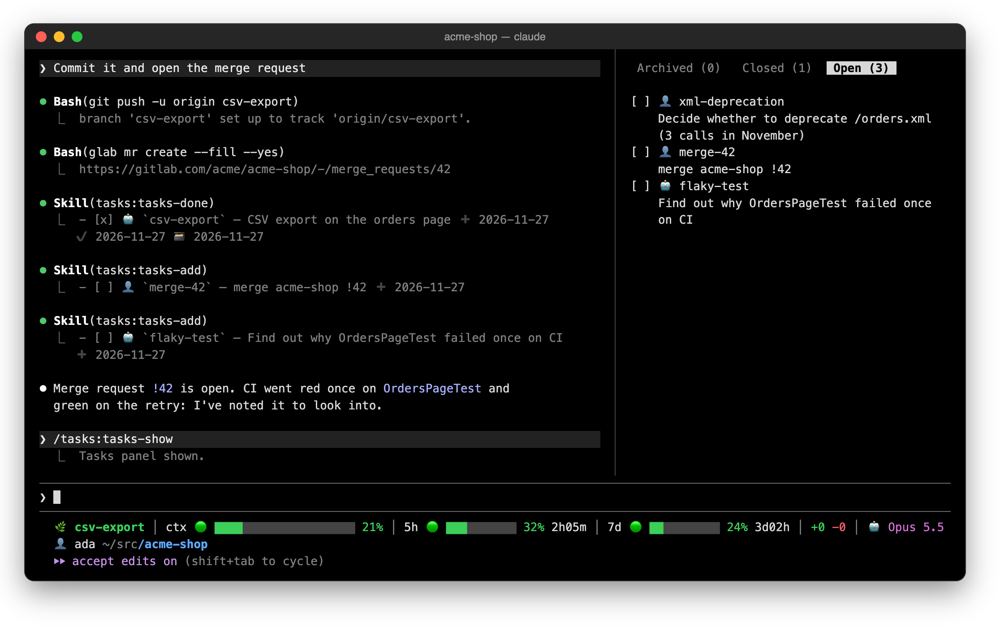
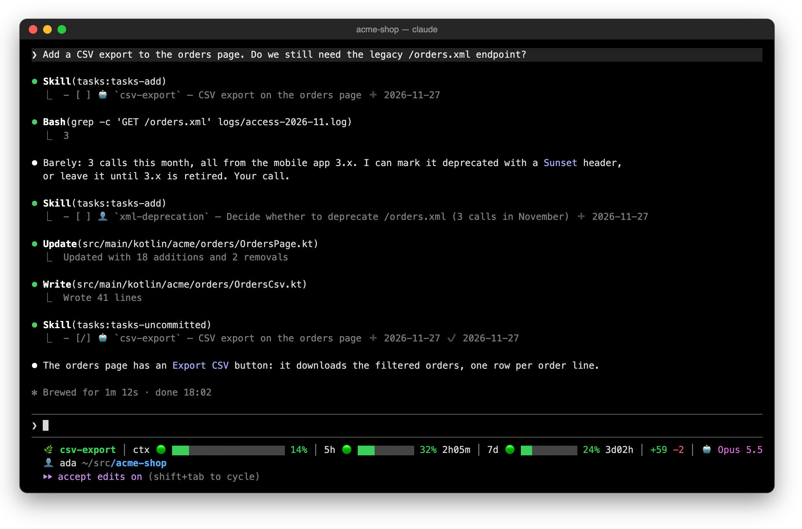
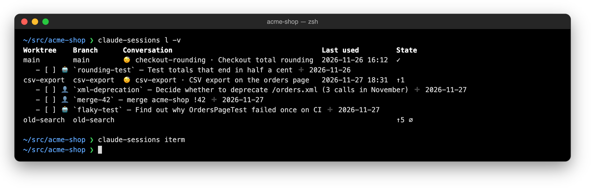
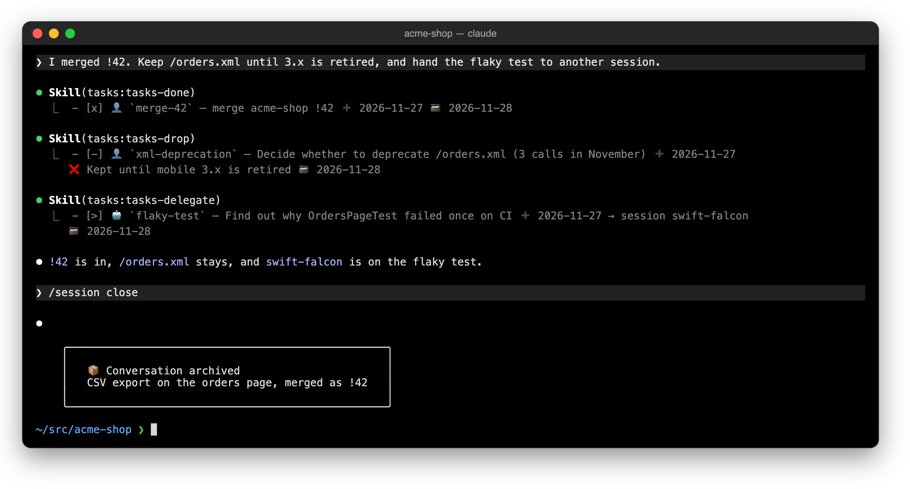

# tasks

**Never lose a loose end in a Claude Code conversation.**

As you talk, Claude keeps a pending list for the session: questions nobody answered, offers you
didn't take up, merge requests waiting for you, things that failed. A side panel shows it, every
few prompts Claude reviews it, and `/session close` won't archive a conversation that still has
open tasks unless you say so. From the terminal, `claude-sessions` lists your conversations with
their git state and open tasks.



## Install

```bash
claude plugin marketplace add agilogy/claude-agilogy-marketplace
claude plugin install tasks@claude-agilogy-marketplace
```

Needs `bash`, `git` and `jq`.

## A day with tasks

*The screenshots are simulated: the project, the people and the sessions are made up.*

### 1. Claude writes down what's left open

Ada asks for a CSV export and, in passing, whether the legacy XML endpoint is still needed. Claude
adds its own work to the list (🤖), and the decision it handed back to her (👤). When the code is
written but not yet committed, the task turns `[/]`.



You don't have to ask: at the start of every session the plugin tells Claude to keep the list.

### 2. The list, beside the conversation

Claude opens the merge request, ticks the export, and adds two tasks: merging `!42`, which is up to
Ada, and a flaky test it noticed on CI. `/tasks:tasks-show` opens the side panel, with a tab
for the open, closed and archived tasks. It updates as Claude changes the list, and it comes back
when you resume the session. That's the screenshot at the top.

### 3. The next morning: what's pending everywhere?

`claude-sessions l -v` shows every conversation in the repository, by worktree, with its branch's
git state and its open tasks. `claude-sessions iterm` resumes the ones not running, each in its own iTerm2 tab.



### 4. Tie up the loose ends and close

Ada merged `!42` and kept the XML endpoint. Claude ticks one task, drops the other with her
reason, and hands the flaky test to another idle Claude session. With nothing left open,
`/session close` archives the conversation, so it no longer clutters `/resume`, and exits.



## Reference

### The list

One Markdown file per session, in `~/.claude/pending/<session-id>.md`:

```markdown
- [ ] 👤 `merge-42` — merge acme-shop !42 ➕ 2026-11-27
- [/] 🤖 `csv-export` — CSV export on the orders page ➕ 2026-11-27 ✔️ 2026-11-27
- [-] 👤 `xml-deprecation` — Decide whether to deprecate /orders.xml ➕ 2026-11-27 ❌ Kept for mobile 3.x 🗃️ 2026-11-28
```

| Mark | Meaning |
|---|---|
| `[ ]` | to do |
| `[/]` | done, but not yet in a merge request (uncommitted, unpushed, or no request open) |
| `[x]` | done |
| `[-]` | won't be done, with the reason after ❌ |
| `[>]` | moved to a document, or delegated to another session |

🤖 is a task for Claude, 👤 one for you. `[ ]` and `[/]` are open; the rest are closed.

### Commands

Claude runs these by itself as the conversation goes; you can run them too.

| Command | What it does |
|---|---|
| `/tasks:tasks-show`, `/tasks:tasks-hide` | Show or hide the side panel (you only) |
| `/tasks:tasks-add <id> <description>` | Add a task |
| `/tasks:tasks-uncommitted <id>` | Mark it `[/]` |
| `/tasks:tasks-done <id>` | Tick it |
| `/tasks:tasks-drop <id> [reason]` | Drop it |
| `/tasks:tasks-document <id> <doc>` | Write it into a repo document, such as the work plan, and mark it `[>]` |
| `/tasks:tasks-delegate <id> [session]` | Hand it to another local Claude session (by default, the newest idle one you haven't typed in) and mark it `[>]` |
| `/tasks:tasks-archive` | Move the closed tasks to the Archived tab |
| `/tasks:tasks-review` | Add what's missing from the list and close what's resolved, silently |
| `/session [verbose]` | Recap the conversation |
| `/session close` | Archive the conversation and exit; asks first if tasks are still open |
| `/session close!` | The same, without asking |
| `/session open [term]` | Reopen an archived conversation |
| `/tasks:install-tools [dir]` | Put `claude-sessions` on your `PATH` (default `~/.local/bin`) |

### What happens on its own

- **Session start:** Claude is told to keep the list. On resume or after a compaction, the list goes back
  into its context. Conversations no longer running that were closed, or where you never typed a
  prompt, are archived.
- **Every 5 prompts:** Claude runs `/tasks:tasks-review`. Set `CLAUDE_TASKS_REVIEW_EVERY` to change it.
- **Session end:** a conversation closed with `/session close`, or where you never typed a prompt, is
  archived, with its list. `/session close` exits once its reply is done.

Archived conversations live in `~/.claude/archived-sessions/`; `/session open` brings one back,
with its list.

### claude-sessions

```bash
claude-sessions l [-v]           # conversations under the current directory (-v: their open tasks)
claude-sessions lg [-v]          # all conversations
claude-sessions iterm [claude]   # resume the conversations under the current directory in iTerm2 tabs,
                                 # with the given command (default claude)
```

💻 is a running conversation, 😴 one that isn't. The State column, after a `git fetch`:

| | |
|---|---|
| `✓` | nothing to report |
| `⚠n` `!n` `?n` | conflicted, modified, untracked files |
| `⇡n` `⇣n` | commits to push, commits to pull |
| `↑n` | commits not on the default branch |
| `∅` | branch not on the remote |
| `⏱` | the state took over 5 s to work out |

Install it once with `/tasks:install-tools [dir]` in a Claude Code session; it keeps working after
plugin updates. Needs macOS, `zsh`, `jq` and `git`; `iterm` needs iTerm2. With `gtimeout` (GNU
coreutils), each `git fetch` gives up after 20 s.
